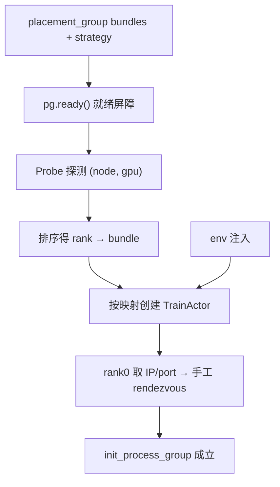

这是 **Ray-Learn** 系列第二篇。上一篇解决的是「资源怎么记账」，这一篇要解决「资源落在哪」。

分布式训练对调度的要求，比普通批处理高一截。普通任务只要「给我 N 个 CPU」就行；训练任务还要知道：这 N 张卡是不是同一批、谁是 rank 0、rank 3 重启之后还是不是同一张物理卡。这些事，靠散落的 `num_gpus=1` 是不够的。

## 一、为什么需要 Placement Group

单个 `num_gpus=1` 的 actor 只能保证「拿到了一张卡」。多 rank 训练还需要三件事：

1. **gang scheduling**：要么一起就绪，要么都别动。避免 16 个 rank 起来了，第 17 个还在排队，前面 16 个干等。
2. **相对位置可控**：TP 组最好在同一台机器上，跨机 TP 会撞网络。PP 的 stage 划分也希望有稳定的拓扑。
3. **共置 / 分离可配置**：rollout 和 trainer 同卡可以省机器，分卡可以省显存。这个选择应该由配置决定，而不是由调度器随机决定。

Placement Group（PG）就是给这三件事用的：

```python
import ray
from ray.util.scheduling_strategies import PlacementGroupSchedulingStrategy

ray.init(num_gpus=4)

pg = ray.util.placement_group(
    bundles=[{'GPU': 1, 'CPU': 1}] * 4,
    strategy='PACK',            # 尽量同节点；STRICT_PACK 强制同节点
)
ray.get(pg.ready())             # gang 就绪屏障

@ray.remote(num_gpus=1)
class Rank:
    def meta(self):
        return {
            'gpu': ray.get_gpu_ids(),
            'node': ray.get_runtime_context().get_node_id(),
        }

actors = [
    Rank.options(
        scheduling_strategy=PlacementGroupSchedulingStrategy(
            placement_group=pg,
            placement_group_bundle_index=i,
        )
    ).remote()
    for i in range(4)
]
print(ray.get([a.meta.remote() for a in actors]))

ray.util.remove_placement_group(pg)
ray.shutdown()
```

几个参数值得单独说：

| 参数 | 语义 | 典型用途 |
| --- | --- | --- |
| `bundles` | 一组资源打包，调度时整体决策 | 一张卡 + 若干 CPU 为一个训练 rank |
| `strategy='PACK'` | 尽量挤在同一节点 | 机内 TP、NVLink |
| `strategy='STRICT_PACK'` | 强制同节点 | 同机不可妥协时 |
| `strategy='SPREAD'` | 尽量打散 | 容错、数据并行 |
| `pg.ready()` | 全部 bundle 就绪，或永远不返回 | gang 屏障 |
| `placement_group_bundle_index` | 把 actor 钉到指定 bundle | rank ↔ bundle 映射 |

`pg.ready()` 值得强调一下。它不是「检查一下有没有资源」，而是**要么整个 PG 都就绪，要么就一直等**。这正是 gang 语义：不允许「起了一半」这种状态进入训练。

### slime 的做法：一个大 PG + 索引偏移

实际工程里还有一种更省事的布局。slime 不给每个角色单独建 PG，而是建一个大 PG，再用索引偏移切角色：

| 模式 | 总 bundle 数 | rollout 起始偏移 | 含义 |
| --- | --- | --- | --- |
| 分离 | actor + rollout | actor_num_gpus | rollout 排在 actor 后面，各占各的 |
| 共置 | max(actor, rollout) | 0 | rollout 与 actor 用同一批 bundle |

好处是：共置和分离用同一张布局表表达，代码里只有一个 `_get_placement_group_layout()`。代价是 offset 算错就会静默错位，所以这个函数通常是全文件里注释最多的。

## 二、bundle 顺序不稳定——这是正确性问题

Ray 分配 `{'GPU': 1} × 8` 时，bundle 与物理 GPU 的对应顺序**不可控**。今天 rank 0 可能落在 GPU 0，下次启动变成 GPU 3。

这件事对纯数据并行或许只是日志难看。但对下面这些情况是直接错误：

- 流水并行：stage 0 和 stage 1 的通信拓扑变了
- 跨 rank 的 NCCL 组：rank 号变了，集合通信顺序就乱了
- 依赖「rank 0 持有全局 buffer」的逻辑：rank 0 不再是那张卡

slime / miles / verl / NeMo-RL 都做了同一件事：**探测物理位置，再重排序**。

```python
import ray
from ray.util.scheduling_strategies import PlacementGroupSchedulingStrategy

@ray.remote(num_gpus=1)
class Probe:
    def where(self):
        return (
            ray.util.get_node_ip_address(),
            ray.get_gpu_ids()[0],
        )

def build_rank_map(pg, num_bundles: int):
    probes = [
        Probe.options(
            scheduling_strategy=PlacementGroupSchedulingStrategy(
                placement_group=pg,
                placement_group_bundle_index=i,
            )
        ).remote()
        for i in range(num_bundles)
    ]
    infos = ray.get([p.where.remote() for p in probes])
    for p in probes:
        ray.kill(p)

    # 逻辑 bundle 下标 -> 按 (node, gpu) 排序后的物理次序
    order = sorted(range(num_bundles), key=lambda i: infos[i])
    return {rank: bundle for rank, bundle in enumerate(order)}
```

流程是：

1. 每个 bundle 上临时起一个探针 actor；
2. 问它「你在哪个节点、哪张卡」；
3. 按 `(node, gpu)` 排序，得到稳定的 rank 映射；
4. 探针杀掉，之后按映射表创建真正的 worker。

:::tip{title="一句话"}
**rank i 永远对应确定的物理位置。** 探测一次、排序一次、之后按表调度。这比「相信 Ray 会记住」可靠得多。
:::

verl 的写法略有不同，它读 `placement_group_table` 按节点 IP 排序；NeMo-RL 在 `RayVirtualCluster` 里记录物理 bundle 顺序。思路一致：**不要依赖调度器的偶然顺序**。

## 三、`ray.get_gpu_ids()`：从账本 id 到进程内设备

actor 进程里，真正回答「该用哪张卡」的 API 是 `ray.get_gpu_ids()`。

```python
import os
import ray

@ray.remote(num_gpus=1)
class TrainActor:
    def __init__(self):
        visible = os.environ.get('CUDA_VISIBLE_DEVICES', '')
        gid = ray.get_gpu_ids()[0]
        # 账本给的 GPU id，翻译成进程内可见设备下标
        self.local_rank = (
            visible.split(',').index(str(gid)) if visible else 0
        )

    def get_local_rank(self) -> int:
        return self.local_rank

ray.init(num_gpus=2)
a = TrainActor.remote()
print(ray.get(a.get_local_rank.remote()))
ray.shutdown()
```

miles 的 `train_actor.py` 就是这个模式：把 Ray 的 GPU id 翻译成 `LOCAL_RANK`，再写进环境变量，交给 Megatron / FSDP。为什么需要翻译？因为 `CUDA_VISIBLE_DEVICES` 里的下标是**进程内**的，而 `ray.get_gpu_ids()` 返回的是**账本层**的 id，两者不一定连续。

:::warning{title="和 CUDA_VISIBLE_DEVICES 的关系"}
设置 `RAY_EXPERIMENTAL_NOSET_CUDA_VISIBLE_DEVICES=1` 时（slime / verl 都这么配），Ray **不会**改写 `CVD`，映射需要自行完成。反之 Ray 会填好设备可见性，但「手动圈定设备」的控制权也就交出去了。两条路只能选一条。
:::

这个选择会影响后面很多事：要不要自己算 local rank、能不能把某几张卡留给子进程、日志里的 GPU 号指账本还是指物理。建议在项目早期就定下来，不要中途换。

## 四、手工 rendezvous：把 N 个 actor 收成进程组

torch.distributed 需要四个环境变量：`MASTER_ADDR`、`MASTER_PORT`、`WORLD_SIZE`、`RANK`。Ray 不会自动填充。slime 用一个 10 行的基类手写 rendezvous：

```python
import socket
import ray

@ray.remote
class RayActor:
    def get_master_addr_and_port(self):
        addr = ray.util.get_node_ip_address()
        with socket.socket() as s:
            s.bind(('', 0))          # 端口 0 = 随机空闲端口
            return addr, s.getsockname()[1]

# 概念代码：rank 0 先起，把地址交给后续 rank
master_addr, master_port = None, None
actors = []
world_size = 4

for rank in range(world_size):
    actor = TrainActor.options(
        scheduling_strategy=PlacementGroupSchedulingStrategy(
            placement_group=pg,
            placement_group_bundle_index=reordered[rank],
        )
    ).remote(world_size, rank, master_addr, master_port)

    if rank == 0:
        master_addr, master_port = ray.get(
            actor.get_master_addr_and_port.remote()
        )
    actors.append(actor)
```

要点按顺序说：

1. **rank 0 先起**。它从所在节点取 IP，从绑定端口 0 的临时 socket 取一个空闲端口。
2. 这个 `(addr, port)` 就是后续所有 rank 的 `MASTER_ADDR` / `MASTER_PORT`。
3. 真正的 `init_process_group` 在 actor 方法里完成。进程组跨 actor 边界，和 Ray 的调度是两层事。

端口用 0 而不是固定值，是为了避免多作业同机冲突。地址用 `get_node_ip_address()` 而不是 `localhost`，是因为跨机时 rank 0 的地址必须是其他节点可达的。

### 多机上的一个高频坑

NCCL 卡在启动阶段，往往**不报错**，只是不动。表现是所有进程都活着，`nvidia-smi` 也正常，就是不往下走。排查顺序建议是：

1. 先跑一个极小的 `all_reduce` 微基准，确认网络通；
2. 再确认 `MASTER_ADDR` 是否其他节点可达；
3. 最后才看模型并行配置。

很多「训练启动失败」的问题，在这三步里就能定位。真上模型再调 NCCL，成本会高很多。

## 五、环境变量是编排的一部分

rendezvous 之前，还有一层「启动期正确性」。slime 的 `utils.py`（75 行）里有三条几乎是必抄的：

| 变量 | 值 | 原因 |
| --- | --- | --- |
| `RAY_USE_UVLOOP` | `0` | 修 async actor 的间歇性故障 |
| `RAY_EXPERIMENTAL_NOSET_*_VISIBLE_DEVICES` | `1` | 设备映射由上层管理 |
| `NCCL_CUMEM_ENABLE` | `0` | 与 SGLang 保持一致，否则 NCCL 报错 |

```python
def add_default_ray_env_vars(extra: dict[str, str]) -> dict[str, str]:
    env = {
        'RAY_USE_UVLOOP': '0',
        'RAY_EXPERIMENTAL_NOSET_CUDA_VISIBLE_DEVICES': '1',
        'NCCL_CUMEM_ENABLE': '0',
    }
    env.update(extra)          # 调用方优先
    return env

RolloutManager.options(
    runtime_env={'env_vars': add_default_ray_env_vars({'RL_STAGE': 'dev'})}
).remote()
```

NeMo-RL 把注入优先级写成了四层，从低到高：类级 `runtime_env`、系统 `export`、实验 YAML、worker 静态配置方法。

「export 了但没生效」多半是被更高层覆盖了。如果只保留一条注入路径，就能少掉一整类 bug——这也是小型项目值得做的取舍：**能少一层配置链，就少一层**。

## 六、这一层在 RLinfra 里的位置

把本篇的机制按依赖关系排一下：



| 机制 | 解决的问题 | 对应源码 |
| --- | --- | --- |
| PG + `pg.ready()` | gang：要么都好，要么都别动 | slime `placement_group.py` |
| bundle 重排序 | rank ↔ GPU 跨重启稳定 | slime / verl / NeMo-RL |
| `get_gpu_ids` | 账本 id → 进程内设备 | miles `train_actor.py` |
| 手工 rendezvous | actor 图 → torch 进程组 | slime `actor_group.py` |
| env 注入 | 启动期一致性 | slime `utils.py` |

下一篇进入数据面与引擎生命周期：推理引擎为什么必须是子进程，rollout 大张量为什么不能当参数传，以及权重广播该怎么做。

## 源码与仓库

| 用途 | 链接 |
| --- | --- |
| 本系列配套练习（20 课脚本 + API 对账） | [MLsys-Note/Ray-Learn](https://github.com/ShaneGZhu/MLsys-Note/tree/main/Ray-Learn) |
| Ray | [ray-project/ray](https://github.com/ray-project/ray) |
| slime（最小编排） | [THUDM/slime](https://github.com/THUDM/slime) |
| miles | [radixark/miles](https://github.com/radixark/miles) |
| verl | [verl-project/verl](https://github.com/verl-project/verl) |
| NeMo-RL | [NVIDIA/NeMo-RL](https://github.com/NVIDIA/NeMo-RL) |
| AReaL | [areal-project/AReaL](https://github.com/areal-project/AReaL) |
| prime-rl | [PrimeIntellect-ai/prime-rl](https://github.com/PrimeIntellect-ai/prime-rl) |
