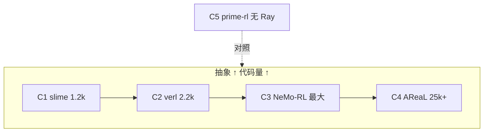

这是 **Ray-Learn** 系列最后一篇。做两件事：把生产里还会用到的 Ray API 面补完，然后把五个主流框架的编排层放在同一张表上对比。

对比的目的不是评出「谁最好」，而是看清一件事：**它们的差异不在会不会用 Ray，而在愿意为抽象付多少行代码。**

## 一、runtime_env：四层覆盖

环境变量是编排的一部分。Ray 场景下注入路径不止一条，NeMo-RL 把优先级文档化成了四层，从高到低：

| 优先级 | 路径 | 用途 |
| ---: | --- | --- |
| 4（最高） | worker 类的静态配置方法 | 按实例微调 |
| 3 | 实验 YAML | 按实验控制 |
| 2 | 系统 `export` | 集群统一 |
| 1（最低） | 类级 `runtime_env={'env_vars': ...}` | 类默认值 |

```python
@ray.remote(runtime_env={'env_vars': {'FOO': 'from_cls'}})
class Worker:
    def foo(self):
        import os
        return os.environ.get('FOO')
```

实测下来有一个容易误判的点：

:::warning{title="options 是替换，不是合并"}
`.options(runtime_env={'env_vars': {...}})` 会**整体替换**类级的 `env_vars`，而不是字典合并。需要叠加时必须显式拼出完整 dict。
:::

另外，凭据不要进 `runtime_env`。它会原样写进 job 日志，miles 在注释里专门提醒过这一点。密钥走环境注入之外的通道，或者至少走不落日志的路径。

## 二、具名 actor 与命名服务

跨进程找单例（KV、控制器、NCCL id 发布点）时，用 `name` + `namespace`：

```python
ray.init(namespace='rlinfra')

KV.options(
    name='kv',
    namespace='rlinfra',
    lifetime='detached',        # 跨 driver 存活
    get_if_exists=True,         # 幂等创建
).remote()

kv = ray.get_actor('kv', namespace='rlinfra')
```

工程上其实是两条路线：

| 路线 | 做法 | 代表 |
| --- | --- | --- |
| 启动时定拓扑 | 显式传 `ActorHandle` | slime |
| 运行中动态发现 | 具名 actor / KV | miles、TransferQueue、AReaL |

第一种更简单，编排器手里握着全部句柄，调试时也好查。问题是「事后查找」做不了：新起的进程不知道去哪里拿句柄。

第二种反过来。AReaL 走得最远：`DistributedKVStore` 是 detached 的命名服务，带 TTL 和租约，引擎之间互相发布 `host:port`。Ray 在这里当**命名基板**，不当消息总线。TransferQueue 的 Controller 也是具名 actor，消费者用 `get_actor` 重连。

怎么选？如果拓扑在启动时就完全确定，传句柄；如果有动态加入、故障后重连、或者跨作业共享状态，上具名服务。

## 三、拓扑：NodeAffinity 与自定义资源

「PACK 偏好」不能替代硬约束。训练池和推理池要么用不同的 PG，要么用不同的自定义资源。

```python
from ray.util.scheduling_strategies import NodeAffinitySchedulingStrategy

ray.init(resources={'nvlink_domain_0': 2})

# 拓扑域约束
Actor.options(resources={'nvlink_domain_0': 1}).remote()

# 钉节点
Actor.options(
    scheduling_strategy=NodeAffinitySchedulingStrategy(
        node_id=node,
        soft=False,             # 调度不到就失败，而不是凑合
    )
).remote()
```

几个典型用法：

| 需求 | 做法 | 谁在用 |
| --- | --- | --- |
| NVLink 域内放 TP 组 | 自定义资源 `nvlink_domain_*` | NeMo-RL |
| 控制器钉 head 节点 | `NodeAffinity` + `is_head_node` | miles |
| 奖励模型贴近数据 | `NodeAffinity(soft=False)` | verl agent loop |
| 训推池隔离 | 不同 PG 或不同自定义资源 | 各家通用 |

NeMo-RL 的做法比较完整：Slurm 脚本给每节点注入 `nvlink_domain_*` / `topo_rank`，`RayVirtualCluster` 按域组 PG。**拓扑正确性进调度，而不是靠人肉对齐。**

`ray.util.placement_group_table(pg)` 能读出 bundle → 节点的映射。verl 用它按节点 IP 排序，保证 rank 跨重启稳定——这是上一篇讲的 bundle 重排序的另一种实现。

## 四、作业生命周期

| 形态 | 入口 | 场景 |
| --- | --- | --- |
| 本地自起 | `ray.init()` | 学习、单机 |
| 接入集群 | `ray.init(address='auto')` | `ray start` 已起好 |
| 作业系统 | `JobSubmissionClient` | KubeRay / 多租户 |
| 平台内自举 | rank0 `ray start --head` | Slurm gang 作业 |

多机验收的通过条件适合写死成断言：

```python
expected = 16  # 规划分给 Ray 的额度
assert ray.cluster_resources()['GPU'] == expected
```

这个断言看起来简单，但它挡掉的是第一篇讲的那类「账本不一致」问题。很多项目把这一步跳过，结果后面所有 rank 映射、PG 布局都建立在错误的账上。

`JobSubmissionClient` 适合「作业系统要管生命周期」的场景：提交、查状态、拉日志、取消。NeMo-RL 的 `nrl_k8s` 用它对接 KubeRay。AReaL 则在 Slurm gang 作业里自举 Ray 集群——rank0 当 head，其他节点 join，head 退出则解散。

## 五、五种编排范式

现在可以回答开头那个问题了。把五个框架的编排层摆在一起：

| 范式 | 代表 | Ray 的角色 | 编排代码量 |
| --- | --- | --- | ---: |
| 命令式 actor_group | slime / miles | 全权：资源 + RPC + 数据面 | 1.2k / 5.1k |
| 声明式 Dispatch/Collect | verl | 藏在 WorkerGroup 后 | 2.2k 抽象层 |
| RayWorkerGroup 四能力 | NeMo-RL | 资源/隔离/协调/通信全覆盖 | 最大 |
| 薄 Ray + HTTP 服务化 | AReaL | **只做 launcher + 命名** | 25k+ 自建 |
| 无 Ray asyncio | prime-rl | 不用 | 6.8k 自建 |

### C1 · slime：最小编排

3 种角色（TrainActor / RolloutManager / Lock）+ 单 PG 偏移切分 + 手工 rendezvous。1,228 行做完全部编排。

适合：目标一万行以内、单环境、角色少。如果正在自建精简 RLinfra，这是最值得先读的参考。

### C2 · verl：编程模型藏住 Ray

```python
@register(dispatch_mode=Dispatch.DP_COMPUTE_PROTO)
def train_batch(self, batch):
    ...
```

调用方写单机语义，框架自动切分 `DataProto`、扇出、收集。代价是抽象层本身两千多行。

还有一个值得单独看的机制：`FusedWorker`。actor + critic + ref 合成一个 Ray actor，再用 `spawn()` 拆成多个虚拟 WorkerGroup。**类级模块化，actor 级共置**，解决的是「逻辑上分开、物理上省卡」的矛盾。

### C3 · NeMo-RL：教科书分层

`RayVirtualCluster`（资源）、`RayWorkerGroup`（隔离）、单进程 Controller（协调）、NCCL 或队列（通信）。**不用 torchrun**，分布式全是 Ray actor。

模块边界最清晰，代码也最多。如果要做多后端、多算法、还要长期演进，这套分层的成本是值得付的。

### C4 · AReaL：Ray 尽量薄

Worker 是 OS 进程，业务走 HTTP RPC。Ray 只负责分配资源、拉起进程、记名字。`fork_workers` 能在同节点不新占卡的情况下再起一个角色。

适合多平台、多租户、agent 服务。代价是两万五千行起，而且故障模式变多——HTTP 超时、重试、半开连接，都要自己处理。

### C5 · prime-rl：干脆不用 Ray

单 driver `Popen` 拉起 trainer / inference / orchestrator，orchestrator 是纯 asyncio，用事件做版本屏障。进程数固定且少时，这样反而简单。

资源账本和故障恢复要另行实现。这提醒了一件事：**Ray 解决的是分布式资源与生命周期问题，不是 RL 算法问题。** 问题规模不够大时，不用 Ray 也是合理选择。



规律很直白：**每加一层抽象，代码量涨一个量级。** 选型前先确认需要哪一层，而不是默认选最「完整」的那个。

## 六、精简 RLinfra 的裁剪清单

如果目标是自建一套 <1 万行的 RL 编排层，slime 路线的取舍大致如下。

**必须保留**

- 单 PG + offset 切分：共置/分离一张布局表
- bundle 重排序：rank ↔ GPU 稳定，这是正确性
- 手工 rendezvous：大约 10 行，绕不开
- 权重更新的版本屏障：准备（可与生成重叠）→ 暂停 → 替换 → 校验 → 恢复

**可以砍掉**

- 多平台抽象：只支持一种环境
- 服务化拆分：单 Driver + 少量角色足够
- 复杂健康恢复：先做好「出错能看见」

**明确不学**

```
ray.serve   ray.train   ray.data   ray.tune   RLlib   ActorPool
```

主流 RL 框架零使用。编排层只做三件事：**拉起、排序、出错能看见。**

## 七、Ray-Learn 系列回顾

| 篇 | 主题 | 关键结论 |
| --- | --- | --- |
| [一](/blog/posts/rlinfra-with-ray-01-actors-and-resources/) | actor 与资源账本 | `num_gpus` 是账本；阻塞饿死 |
| [二](/blog/posts/rlinfra-with-ray-02-placement-and-rank/) | PG 与 rank 稳定 | bundle 重排序是正确性 |
| [三](/blog/posts/rlinfra-with-ray-03-async-engines-data-plane/) | 引擎与数据面 | 子进程 + 引用传递 + 版本屏障 |
| 本篇 | 生产 API 与范式 | 抽象每加一层，代码涨一个量级 |
| [五](/blog/posts/rlinfra-with-ray-05-multinode-concurrency-process/) | 多机、并发池、进程监督 | 角色资源进 bundle |
| [六](/blog/posts/rlinfra-with-ray-06-api-inventory/) | API 对账与源码地图 | 读框架时的速查表 |

配套仓库 `Ray-Learn` 提供 20 课可运行脚本与 API 对账表。读源码可以从 slime 的 `slime/ray/` 开始——1,228 行，适合整个通读一遍；读完再看 verl 的 `single_controller/`，会更清楚「抽象贵在哪里」。

## 源码与仓库

| 用途 | 链接 |
| --- | --- |
| 本系列配套练习（20 课脚本 + API 对账） | [MLsys-Note/Ray-Learn](https://github.com/ShaneGZhu/MLsys-Note/tree/main/Ray-Learn) |
| Ray | [ray-project/ray](https://github.com/ray-project/ray) |
| slime（最小编排） | [THUDM/slime](https://github.com/THUDM/slime) |
| miles | [radixark/miles](https://github.com/radixark/miles) |
| verl | [verl-project/verl](https://github.com/verl-project/verl) |
| NeMo-RL | [NVIDIA/NeMo-RL](https://github.com/NVIDIA/NeMo-RL) |
| AReaL | [areal-project/AReaL](https://github.com/areal-project/AReaL) |
| prime-rl | [PrimeIntellect-ai/prime-rl](https://github.com/PrimeIntellect-ai/prime-rl) |
